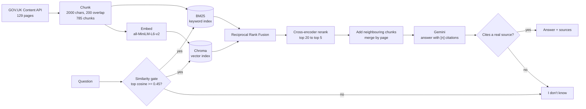

---
title: GOV.UK RAG Assistant
emoji: 📚
sdk: docker
app_port: 7860
pinned: false
short_description: Cited answers about UK visas, right to work and benefits
---

# GOV.UK RAG Assistant

Ask a question about UK visas, right to work, employment rights or benefits and get a **short answer with citations to the exact GOV.UK page it came from**. If the indexed pages don't cover the question, it says *"I don't know"* instead of guessing.

**Live demo:** https://huggingface.co/spaces/VamsiKattera/govuk-rag
(free tier: the first request after a quiet period can take ~30 s while the Space wakes up)

> Not legal advice. Answers come only from the ~130 GOV.UK pages I indexed and may be out of date.

<!-- Add a screenshot or GIF here: docs/demo.gif -->

## What it does

- **Hybrid retrieval**: dense embeddings plus BM25, merged with Reciprocal Rank Fusion, then re-ranked with a cross-encoder.
- **Grounded answers**: Gemini answers using only the retrieved pages and cites them as `[1]`, `[2]`.
- **Knows when not to answer**: a similarity gate stops obviously unrelated questions before any LLM call, and the prompt tells the model to refuse when the sources don't help.
- **Cite or abstain**: an answer that cites no real source is turned into a refusal.
- **A real service**: FastAPI with validation, rate limiting, structured logs, a metrics endpoint, tests, CI and a Docker image, plus a Streamlit UI.

## Architecture



## Results

Measured on a **42-question test set I built** (questions generated from random chunks with Gemini, then reviewed by hand and edited) plus **10 out-of-scope questions**, 3 of them deliberately close to the topic (US work visa, German minimum wage, Canadian work permit). One question is worth about 2.4 percentage points, so small differences are noise.

### Retrieval (is the right page in the top results?)

| Mode | Hit@1 | Hit@3 | Hit@5 | MRR@5 | Chunk@5 |
|---|---|---|---|---|---|
| Vector only | 74% | 93% | 95% | 0.83 | 90% |
| BM25 only | 67% | 98% | 98% | 0.80 | 88% |
| Hybrid (RRF) | 86% | 95% | 98% | 0.91 | 93% |
| Hybrid + rerank | 86% | 95% | 98% | 0.90 | **98%** |

*Hit@k: a chunk from the right page is in the top k. Chunk@5: the exact chunk the question was written from is in the top 5 (stricter).* Hybrid search lifts Hit@1 from 74% to 86%; reranking does not beat hybrid on page-level hits (a tie on this set) but finds the exact source chunk more often (98% vs 93%).

### "I don't know" gate (similarity threshold, before the LLM)

| Threshold | In-scope questions answered | Out-of-scope refused |
|---|---|---|
| 0.40 | 100% | 70% |
| **0.45 (used)** | **100%** | **80%** |
| 0.50 | 98% | 90% |
| 0.55 | 93% | 90% |

The gate alone cannot separate near-topic questions (the German minimum-wage question scores 0.57, higher than some real questions), which is why the model is also told to refuse and why answers must cite a real source.

### Answer quality (LLM-judged)

| Mode | Accuracy | Hallucination | False refusals | Out-of-scope refused | p50 latency | p95 latency |
|---|---|---|---|---|---|---|
| Hybrid + rerank | 95% (40/42) | 2% (1/41 answered) | 2% (1/42) | 100% (10/10) | 2.6 s | 3.0 s |

Answer model and judge: `gemini-flash-lite-latest`. Latency covers requests that called the LLM, measured locally on a CPU laptop in a quiet period; in busier periods on the Gemini free tier I measured a p50 of 4-7 s and a p95 of about 9.5 s, so treat it as a range.

**Known failures:** (1) "Can I work full-time on a Graduate visa?" is refused: the page says you can work in most jobs but never mentions hours, and the model would not give a partial answer. (2) A "list all the types of statutory pay and leave" question gets an incomplete list. (3) The judge flagged one answer (travel while waiting for a Graduate visa decision) for citing a source that did not contain the rule.

**Caveats:** the same model family writes and judges the answers, which tends to be generous, so I spot-checked samples by hand. The test set is small and its questions come from the indexed chunks, so it favours answerable questions. Treat the numbers as a regression test, not a benchmark.

## Things I learned building it

- **Boundaries lose answers.** The chunk that held "you can work in most jobs" was never retrieved because it sat just before the chunk that matched. Adding the neighbouring chunks of the best hits (and removing the duplicated overlap) fixed it.
- **Citations must match what the user sees.** Numbering chunks but showing de-duplicated pages gave answers citing `[3]` with no source `[3]`. Sources are now numbered per page and only cited pages are returned.
- **Prompt examples leak.** An example sentence in the prompt appeared at the end of unrelated answers. I removed the example and added a test that it stays out.
- **LLM output needs defensive parsing.** The model copied section numbers (`[1.a]`) from a source document; the parser now accepts that form, and answers with no valid citation become refusals.
- **Strict refusal rules cost recall.** Making the model refuse unless the sources fully answer the question gave 100% out-of-scope refusal but also refused a question that was only partly covered. Cutting false refusals further means a looser prompt, and that trades against hallucination.
- **Model aliases move.** `gemini-flash-latest` started resolving to a model with a 20-requests-per-day free quota, which stopped an evaluation run. The service now has timeouts, one retry on 5xx or timeout, and an optional fallback model.

## API

```bash
curl -X POST http://localhost:8000/ask \
  -H "Content-Type: application/json" \
  -d '{"question": "Can I travel abroad on a Graduate visa?"}'
```

```json
{
  "request_id": "6c1b3ca67aea",
  "answer": "Yes, with a Graduate visa you can travel abroad and return to the UK [1]. ...",
  "answered": true,
  "sources": [{"n": 1, "title": "Graduate visa", "url": "https://www.gov.uk/graduate-visa", "updated": "2024-10-31T17:01:07+00:00"}],
  "best_similarity": 0.609,
  "retrieve_ms": 1585,
  "total_ms": 3145
}
```

| Endpoint | Purpose |
|---|---|
| `POST /ask` | Ask a question (3-500 characters; optional `mode`: `vector`, `bm25`, `hybrid`, `rerank`) |
| `GET /health` | Liveness check |
| `GET /metrics` | Request counts, refusals, errors, rolling p50/p95 latency |
| `GET /docs` | Interactive OpenAPI docs |

Every response carries an `X-Request-ID`. Logs are JSON, and question text is hashed rather than stored unless `LOG_QUESTIONS` is set.

### Configuration

| Variable | Default | Meaning |
|---|---|---|
| `GEMINI_API_KEY` | required | Google AI Studio key (never commit it) |
| `GEMINI_MODEL` | `gemini-flash-lite-latest` | Answer model |
| `GEMINI_FALLBACK_MODEL` | empty | Tried if the main model keeps failing |
| `MIN_SIM` | `0.45` | Similarity gate threshold |
| `TOP_K` | `5` | Chunks kept after reranking |
| `NEIGHBOURS` | `1` | Neighbouring chunks added for the top 2 hits (0 = off) |
| `RETRIEVAL_MODE` | `rerank` | Default retrieval mode |
| `LLM_TIMEOUT_MS` | `60000` | Per-call Gemini timeout |
| `RATE_LIMIT_PER_MIN` / `DAILY_LIMIT` | `10` / `300` | Per-IP and global limits |
| `TRUST_PROXY` | off | Use the last `X-Forwarded-For` entry as the client IP |

## Run it yourself

```powershell
python -m pip install -r requirements.txt
python scrape.py            # download the pages
python chunk.py             # split into chunks -> data/chunks.jsonl
python index.py             # build the vector index
$env:GEMINI_API_KEY = "your-key"
python -m uvicorn api:app --port 8000
python -m streamlit run ui.py     # UI on http://localhost:8501
```

Tests (no models, no API key needed):

```powershell
python -m pip install -r requirements-test.txt
python -m pytest -q
```

Evaluation:

```powershell
python run_eval.py                    # retrieval + gate tables
python run_eval.py --answers rerank   # adds LLM-judged answer quality (about 90 Gemini calls)
```

Docker (one container runs the API on 8000 and the UI on 7860):

```bash
docker build -t govuk-rag .
docker run -p 7860:7860 -e GEMINI_API_KEY=your-key govuk-rag
```

## Limitations

- Covers about 130 pages in the topics above. Anything else gets "I don't know".
- GOV.UK changes; the index is a snapshot (each source shows its last-updated date).
- Single-turn: no conversation memory.
- Retrieval runs a cross-encoder on CPU, so expect a few seconds per question on free hosting.
- Depends on the Gemini free tier, which can be slow or rate-limited at busy times.
- General guidance only, not legal advice.

## Data and licence

Page content is public sector information from [GOV.UK](https://www.gov.uk), used under the [Open Government Licence v3.0](https://www.nationalarchives.gov.uk/doc/open-government-licence/version/3/). This project is not affiliated with or endorsed by GOV.UK or the UK Government.

## Stack

Python, FastAPI, Streamlit, Chroma, sentence-transformers (`all-MiniLM-L6-v2`, `cross-encoder/ms-marco-MiniLM-L-6-v2`), rank-bm25, Google Gemini, pytest, GitHub Actions, Docker.
